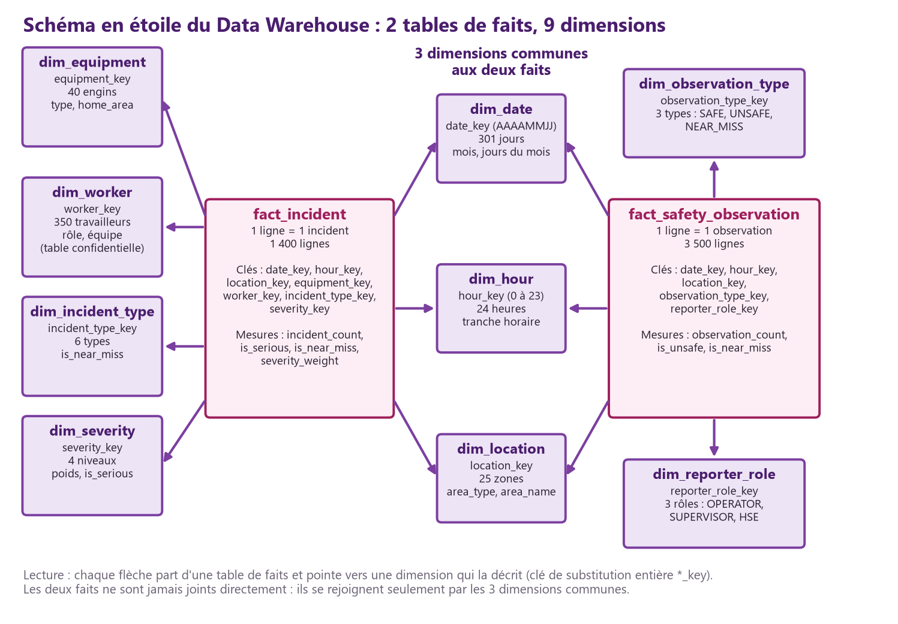

# 4. Data Warehouse : grain, faits, dimensions et schéma en étoile

## 4.1 Objectif

Le Data Warehouse (DWH) est la base qui range les données pour l'analyse. Les fichiers sources sont faits pour enregistrer les événements. Le DWH, lui, est organisé pour compter vite : par mois, par zone, par gravité, par équipe. Cette section décrit son modèle. *Source : sujet, étape 3 ; `04_ETL/dwh_conception.md`.*

## 4.2 Ce que nous avons fait

**Le grain.** Le grain dit ce que représente une ligne d'une table. Nous avons choisi le grain le plus fin : une ligne par événement. Exemple : l'incident `INC000276` du 1er janvier 2026 occupe exactement une ligne de `fact_incident`. *Source : `04_ETL/dwh_conception.md`, § 1.*

**Tableau 7. Grain des deux tables de faits**

| Table de faits | Une ligne représente | Clé métier | Lignes |
|---|---|---|---|
| `fact_incident` | 1 incident | `incident_id` | 1 400 |
| `fact_safety_observation` | 1 observation de sécurité | `observation_id` | 3 500 |

Le tableau 7 montre deux tables de faits et non une seule. Une table de faits contient les événements que l'on compte. Un incident est un événement qui a eu lieu, avec un engin, un travailleur et une gravité. Une observation est un constat de terrain, sans engin ni gravité. Les deux n'ont pas les mêmes colonnes : nous les gardons séparés. *Source : `04_ETL/dwh_conception.md`, § 1 et § 6 ; base `project_11_dwh.db`.*

**Les dimensions.** Une dimension décrit un axe d'analyse : la date, la zone, la gravité. Exemple : la ligne « LOC015 » de `dim_location` porte le type de zone `YARD` (parc à conteneurs). Le modèle compte 9 dimensions.

**Tableau 8. Les 9 dimensions du Data Warehouse**

| Dimension | Lignes | Contenu | Utilisée par |
|---|---|---|---|
| `dim_date` | 301 | un jour par ligne, du 1er janvier au 28 octobre 2026 | les 2 faits |
| `dim_hour` | 24 | heure et tranche horaire | les 2 faits |
| `dim_location` | 25 | zone, type de zone, nom | les 2 faits |
| `dim_equipment` | 40 | engin, type, `home_area` | incidents |
| `dim_worker` | 350 | travailleur synthétique, rôle, équipe | incidents |
| `dim_incident_type` | 6 | COLLISION, EQUIPMENT, FALL, NEAR_MISS, PPE, SPILL | incidents |
| `dim_severity` | 4 | LOW, MEDIUM, HIGH, CRITICAL, poids, indicateur « grave » | incidents |
| `dim_observation_type` | 3 | SAFE, UNSAFE, NEAR_MISS | observations |
| `dim_reporter_role` | 3 | rôle du déclarant : OPERATOR, SUPERVISOR, HSE | observations |

Le tableau 8 montre que trois dimensions (date, heure, zone) servent aux deux faits. C'est par elles que l'on compare incidents et observations, par exemple dans une même zone. Le rôle du travailleur impliqué et le rôle du déclarant sont deux notions différentes : elles ont deux dimensions distinctes. *Source : `04_ETL/dwh_conception.md`, § 2 ; comptages dans `project_11_dwh.db`.*

**Les clés de substitution.** Chaque dimension reçoit une clé entière créée par le pipeline, appelée clé de substitution. Exemple : la gravité `CRITICAL` porte la clé `severity_key = 4`. Les tables de faits ne stockent que ces clés. L'identifiant d'origine reste dans la dimension, pour la traçabilité. *Source : `04_ETL/dwh_conception.md`, § 2.*

**Les mesures.** Une mesure est un nombre que l'on additionne. `fact_incident` en porte quatre : `incident_count` (toujours 1), `is_serious` (1 si l'incident est grave), `is_near_miss` (1 si c'est un presque-accident) et `severity_weight` (poids de 1 à 4). `fact_safety_observation` en porte trois : `observation_count`, `is_unsafe` et `is_near_miss`. *Source : `04_ETL/dwh_conception.md`, § 3.*

**Figure 1. Schéma en étoile : 2 tables de faits et 9 dimensions**

La figure 1 se lit du centre vers l'extérieur. Chaque table de faits est au centre d'une étoile. Chaque flèche pointe vers une dimension qui décrit le fait. `fact_incident` a 7 dimensions, `fact_safety_observation` en a 5. Les trois dimensions du milieu sont communes. Aucune flèche ne relie les deux faits : on ne les joint jamais directement. *Source : `04_ETL/dwh_conception.md`, § 4 ; `11_ARCHITECTURE/faire_schemas.py`.*

## 4.3 Pourquoi ces choix

Le service HSE pose quatre questions : où, quand, comment et à qui arrivent les incidents. Chaque question correspond à une dimension : la zone, la date et l'heure, le type et la gravité, le rôle et l'équipe. Le schéma en étoile permet de répondre à chacune par une seule jointure entre un fait et une dimension. *Source : `README.md`, objectif ; `04_ETL/dwh_conception.md`.*

Le grain fin garde toutes les possibilités. À partir d'une ligne par incident, on peut compter par mois, par zone ou par équipe. L'inverse est impossible : un total par mois ne permet pas de retrouver les zones.

Les mesures 0/1 simplifient les calculs. La somme de `is_serious` donne le nombre d'incidents graves : 312. Sa moyenne donne leur part : 22,3 %. *Source : `04_ETL/dwh_conception.md`, § 6 ; `mart_kpi_summary`.*

## 4.4 Résultat

Le DWH contient 2 tables de faits et 9 dimensions. À chaque exécution, le pipeline vérifie cinq points sur chaque table de faits : le nombre de lignes est celui de la couche précédente, aucune clé n'est vide, le grain est unique, chaque clé existe dans sa dimension, et la somme de la mesure de comptage égale le nombre de lignes. Les cinq contrôles passent pour les deux faits. Un échec arrête le pipeline. *Source : `04_ETL/etl_pipeline.py`, étape 5.4.*

## 4.5 Limites et hypothèses

Le sujet ne fournit pas certaines définitions. Le groupe a posé quatre hypothèses.

**Tableau 9. Hypothèses du groupe sur le modèle**

| N° | Hypothèse | Raison | Effet |
|---|---|---|---|
| H1 | Poids de gravité : LOW = 1, MEDIUM = 2, HIGH = 3, CRITICAL = 4 | Le dictionnaire fourni ne donne aucun poids | Mesure disponible, non utilisée dans les tables d'analyse |
| H2 | Un incident « grave » est de gravité HIGH ou CRITICAL | Le sujet ne définit pas « grave » | Base du KPI « incidents graves » (22,3 %) et du score de risque |
| H3 | Quatre tranches horaires de 6 heures (nuit, matin, après-midi, soir) | Les horaires des équipes A, B et C ne sont pas fournis | Les tranches ne remplacent pas l'équipe |
| H4 | `home_area` est gardée sans lien avec les zones | Les codes `Yxx` ne correspondent à aucune zone `LOCxxx` | Aucune analyse par zone de rattachement des engins |

Le tableau 9 signale ce qui dépend d'un choix du groupe. H2 est l'hypothèse la plus importante : si le service HSE retient une autre définition de « grave », le KPI2 et le score de risque changent. H4 est une limite des données : sur 40 engins, aucun n'a une zone de rattachement reconnue. *Source : `04_ETL/dwh_conception.md`, § 5 ; règle DQ11 dans `dq_results`.*

Autre limite : les sources ne contiennent pas d'heures travaillées. Le taux d'incidents par rôle et par équipe est donc calculé par effectif, et non par heure d'exposition. `dim_worker` contient l'identifiant du travailleur : la table est classée confidentielle (section 7). *Source : `04_ETL/dwh_conception.md`, § 2 et § 6.*
