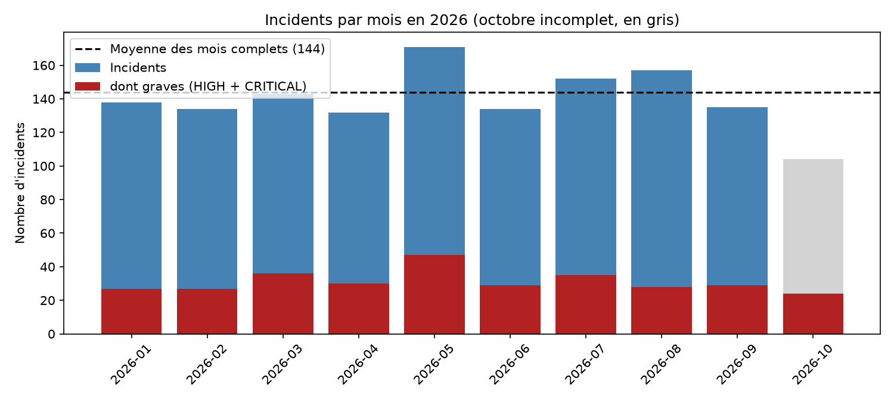
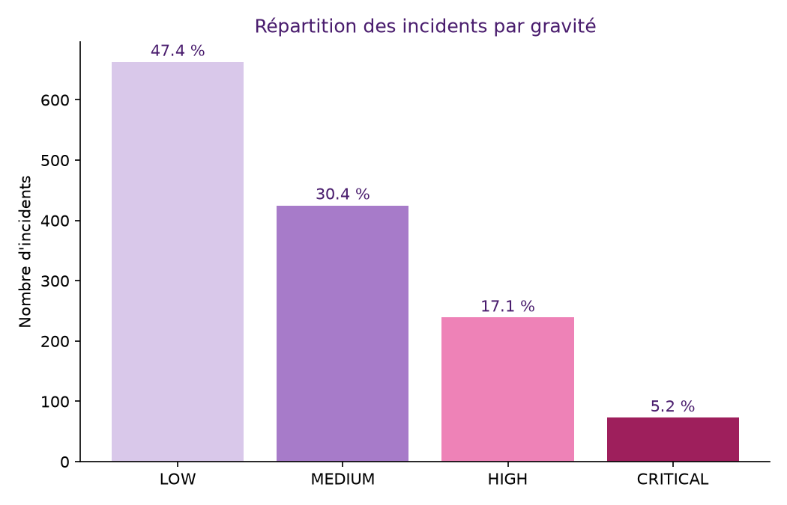
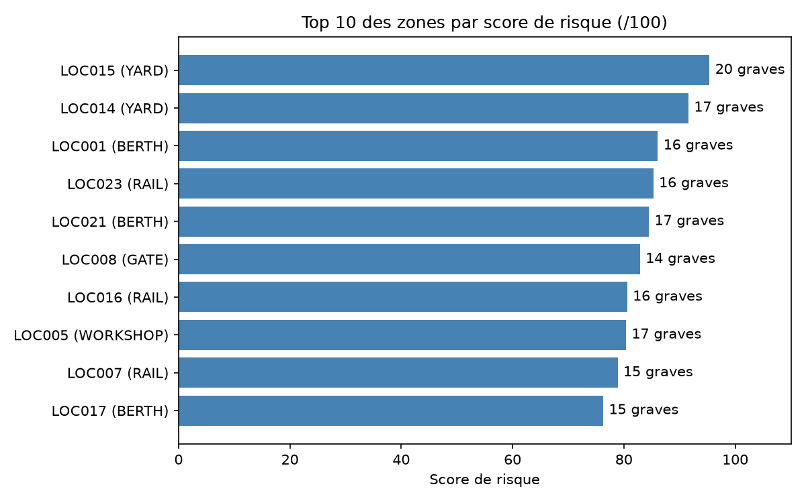
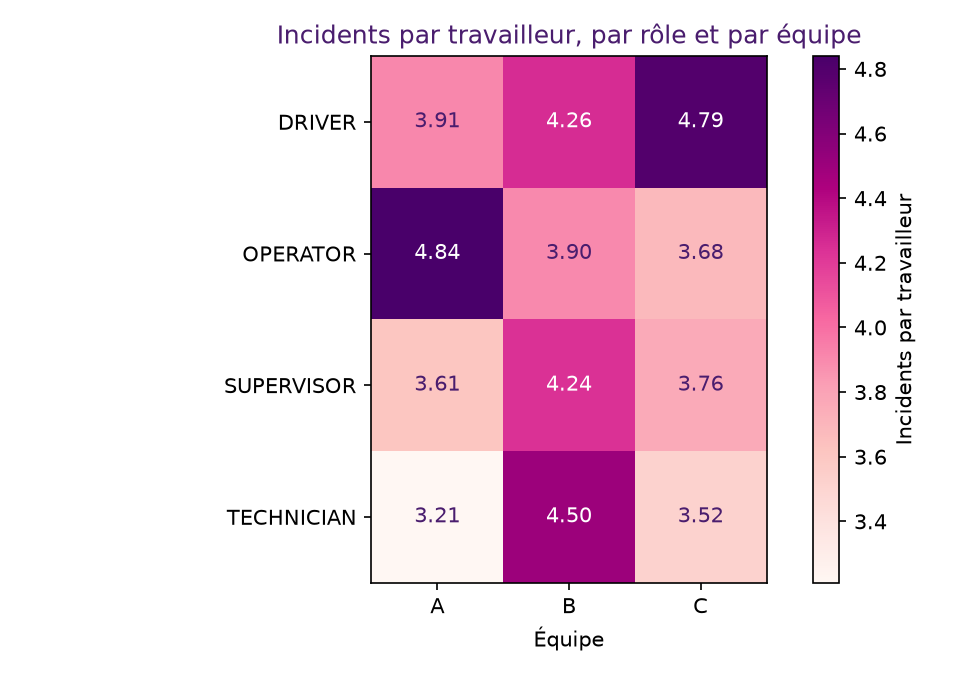
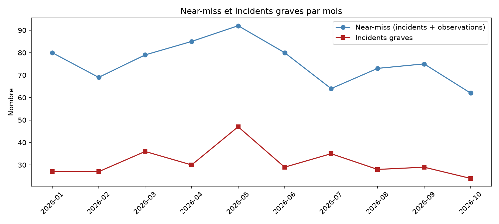
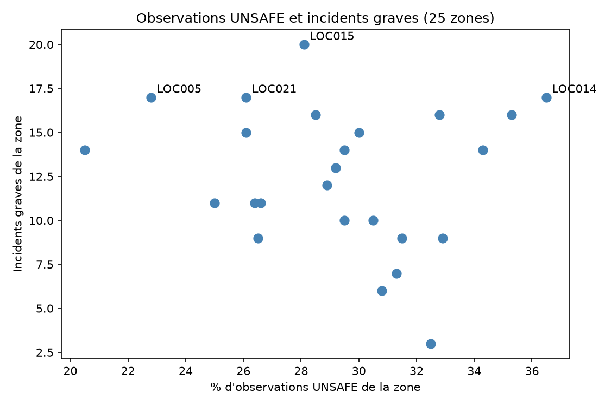

# 8. Analyse exploratoire en Python (EDA)

## 8.1 Objectif

L'analyse exploratoire, ou EDA (Exploratory Data Analysis), consiste à décrire les données par des statistiques et des graphiques pour y repérer des tendances. Le sujet demande au moins trois graphiques interprétés. Nous en présentons six, chacun relié à une question du service HSE. *Source : sujet, étape 7 et § 5.*

## 8.2 Ce que nous avons fait

L'analyse est un notebook Python, `eda_projet11.ipynb`. Un notebook est un document qui mêle code, résultats et texte. Il lit uniquement les tables MART du Data Warehouse : il ne relit jamais les fichiers sources et n'accède à aucun identifiant de travailleur. Les graphiques sont enregistrés dans `07_EDA/figures`. *Source : `07_EDA/eda_projet11.ipynb`.*

**Tableau 19. Statistiques descriptives du nombre d'incidents par mois**

| Périmètre | Mois | Moyenne | Écart-type | Minimum | Médiane | Maximum |
|---|---|---|---|---|---|---|
| Mois complets (janvier à septembre) | 9 | 144,0 | 13,3 | 132 (avril) | 138 | 171 (mai) |
| Tous les mois (avec octobre, incomplet) | 10 | 140,0 | 17,8 | 104 (octobre) | 136,5 | 171 (mai) |

Le tableau 19 résume la série mensuelle. L'écart-type mesure la dispersion autour de la moyenne. Sur les mois complets, il vaut 13,3, soit 9 % de la moyenne : le volume est stable. La médiane (138) est plus basse que la moyenne (144,0), parce que mai tire la moyenne vers le haut. La seconde ligne montre l'effet d'octobre : en l'incluant, la moyenne baisse à 140,0 et le minimum tombe à 104, alors que ce mois ne compte que 28 jours. C'est pourquoi tous nos calculs utilisent la première ligne. *Source : statistiques calculées par le groupe sur la table `mart_incidents_month` (écart-type d'échantillon).*

 

**Figure 2. Incidents par mois en 2026 (à gauche).** Le volume reste entre 132 et 157 incidents par mois, sans tendance nette, sauf en mai : 171 incidents, soit +29,5 % par rapport à avril, avec la plus forte part d'incidents graves (27,5 %). Octobre, en gris, paraît bas (104), mais il s'arrête au 28 : on ne peut pas conclure à une amélioration. *Source : `07_EDA/eda_projet11.ipynb`, graphique 1.*

**Figure 3. Répartition des incidents par gravité (à droite).** Près de la moitié des incidents sont de gravité faible (`LOW` : 663, soit 47,4 %). Mais 312 incidents sont graves, soit 22,3 % : 239 `HIGH` et 73 `CRITICAL`. Plus d'un incident sur cinq est donc grave. *Source : `07_EDA/eda_projet11.ipynb`, graphique 2.*

 

**Figure 4. Les dix zones au score de risque le plus élevé (à gauche).** Le score de risque, sur 100, combine trois éléments : les incidents graves (50 %), le nombre d'incidents (30 %) et la part d'observations `UNSAFE` (20 %). Les deux premières zones sont des parcs à conteneurs : LOC015 (score 95,4 ; 20 incidents graves) et LOC014 (91,6 ; 17 graves). *Source : `07_EDA/eda_projet11.ipynb`, graphique 3.*

**Figure 5. Incidents par travailleur, par rôle et par équipe (à droite).** Chaque case est un groupe. Le plus exposé est celui des opérateurs de l'équipe A : 4,84 incidents par travailleur (121 incidents pour 25 personnes). Suivent les conducteurs de l'équipe C (4,79) et les techniciens de l'équipe B (4,50). Le moins exposé est celui des techniciens de l'équipe A (3,21). L'écart reste modéré et les groupes sont petits (21 à 41 personnes) : c'est un signal à vérifier, pas une preuve. *Source : `07_EDA/eda_projet11.ipynb`, graphique 4.*

 

**Figure 6. Near-miss et incidents graves par mois (à gauche).** On compte 759 near-miss pour 312 incidents graves, soit environ 2,4 near-miss par incident grave. Les near-miss varient peu (62 à 92 par mois). Les incidents graves varient davantage (24 à 47). Le ratio est le plus bas en juillet (1,83) et en mai (1,96). La corrélation entre les deux séries est de +0,59, sur 10 mois seulement. *Source : `07_EDA/eda_projet11.ipynb`, graphique 5.*

**Figure 7. Part d'observations UNSAFE et incidents graves, par zone (à droite).** Chaque point est une zone. Les points ne s'alignent pas : la corrélation est faible et légèrement négative (−0,14). LOC015, la zone la plus touchée (20 incidents graves), n'a que 28,1 % d'observations `UNSAFE`. LOC006 en a 32,5 % pour seulement 3 incidents graves. *Source : `07_EDA/eda_projet11.ipynb`, graphique 6.*

## 8.3 Pourquoi ces choix

Chaque graphique répond à une question du service HSE : quand (figure 2), avec quelle gravité (figure 3), où (figure 4), à qui (figure 5). Les figures 6 et 7 testent deux idées courantes en prévention : « les presque-accidents annoncent les accidents » et « les observations de terrain repèrent les zones dangereuses ». *Source : `07_EDA/eda_projet11.ipynb`, titres des graphiques.*

Lire uniquement les tables MART a deux avantages. L'analyse utilise les mêmes chiffres que le dashboard. Et l'analyste n'a pas accès aux données confidentielles (section 7).

## 8.4 Résultat : les tendances et leur interprétation métier

- **Le pic de mai.** C'est le fait le plus marquant : plus d'incidents, et plus graves. La règle de qualité DQ10 le signale aussi automatiquement. Action proposée : chercher la cause (activité, saison, effectif). *Source : notebook, graphique 1 ; `dq_results`, DQ10.*
- **Le parc à conteneurs.** Il concentre les deux zones au score le plus élevé, et la plus forte part d'incidents graves (28,0 %, section 3). Action proposée : y renforcer les rondes en priorité. *Source : notebook, graphique 3 ; requête Q03.*
- **Les signaux faibles.** Le ratio near-miss / incidents graves baisse quand les incidents graves montent (mai, juillet). Deux lectures sont possibles : plus d'accidents graves, ou moins de déclarations. Action proposée : encourager la déclaration des near-miss et suivre ce ratio chaque mois. *Source : notebook, graphique 5.*
- **Les observations ne suffisent pas.** La part d'observations `UNSAFE` ne désigne pas les zones où les incidents graves se produisent. Il faut la croiser avec l'historique des incidents : c'est ce que fait le score de risque. *Source : notebook, graphique 6.*

## 8.5 Limites et hypothèses

- **Corrélation n'est pas causalité.** La corrélation de +0,59 repose sur 10 points. Elle reflète surtout le volume d'activité du mois, et non un lien de cause à effet. *Source : notebook, graphique 5.*
- **Score de risque.** Les pondérations 50 / 30 / 20 sont un choix du groupe : le sujet ne donne pas de formule. Le score compare les zones entre elles ; ce n'est pas une probabilité. *Source : `10_EXPECTED_KPIS/kpi_catalog.csv`, KPI3.*
- **Taux par effectif.** Sans heures travaillées, le taux par rôle et par équipe ne mesure pas l'exposition réelle. L'équipe est celle de la fiche du travailleur, et non celle de l'heure de l'incident. *Source : notebook, conclusion ; `kpi_catalog.csv`, KPI6.*
- **Données synthétiques.** Les tendances illustrent la méthode d'analyse. *Source : sujet, § 2.*
- [À COMPLÉTER : relecture de cette section par Fatouma, auteure de l'analyse exploratoire]
