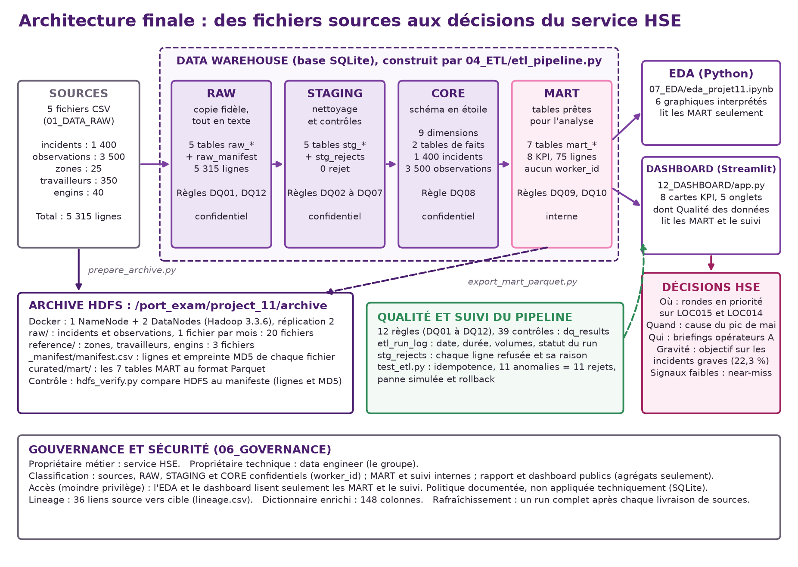

# 10. Architecture finale

## 10.1 Objectif

Cette section assemble toutes les briques du projet en un seul schéma, du fichier source à la décision du service HSE. *Source : sujet, étape 8.*

## 10.2 Ce que nous avons fait

**Figure 8. Architecture finale du projet**

La figure 8 se lit de gauche à droite. Les cinq fichiers sources entrent dans le Data Warehouse et traversent ses quatre couches. Les règles de qualité sont indiquées dans la couche où elles s'appliquent. À droite, les tables MART alimentent l'analyse Python et le dashboard, qui servent les décisions du service HSE. En bas à gauche, l'archive HDFS reçoit les fichiers sources découpés par mois, puis les tables MART au format Parquet. En bas au centre, le suivi de la qualité alimente l'onglet « Qualité des données » du dashboard. Le bandeau du bas rappelle les règles de gouvernance, qui s'appliquent à toute la chaîne. *Source : `06_GOVERNANCE/lineage.csv` (36 liens) ; `11_ARCHITECTURE/faire_schemas.py`.*

**Tableau 21. Les composants de l'architecture**

| Composant | Outil | Rôle | Mise à jour |
|---|---|---|---|
| Base source | SQLite, SQL | Vérifier les sources, premiers KPI | À la demande |
| Data Warehouse | SQLite, Python (pandas) | Contrôler, modéliser, agréger | Un run complet à chaque livraison de sources |
| Archive | HDFS (Hadoop 3.3.6, Docker) | Conserver l'historique brut et les MART | Après chaque run |
| Analyse | Notebook Python (pandas, matplotlib) | Graphiques et interprétation | À la demande |
| Dashboard | Streamlit | Afficher les KPI et la qualité | Lit la base à chaque ouverture |
| Suivi | Tables `dq_results`, `etl_run_log` | Tracer les contrôles et les runs | À chaque run |

Le tableau 21 montre des outils volontairement simples. SQLite est une base contenue dans un seul fichier, sans serveur à installer. Elle suffit pour 5 315 lignes et rend le projet reproductible sur n'importe quel ordinateur. *Source : `requirements.txt` ; scripts de chaque dossier ; `06_GOVERNANCE/GOVERNANCE_CHECKLIST.md`, § 5. La mise à jour de l'archive « après chaque run » est une proposition du groupe.*

**Le dashboard.** Le dashboard est une application Streamlit. Il affiche les 8 KPI sous forme de cartes, puis cinq onglets : évolution mensuelle, zones à risque, rôles et équipes, signaux faibles et types, qualité des données. Trois filtres permettent de choisir la période, les types de zone et les équipes. Il lit les tables MART et les tables de suivi. Il est en ligne à l'adresse https://projet11-port-safety.streamlit.app/ . Si la base n'existe pas au démarrage, l'application lance le pipeline pour la construire. *Source : `12_DASHBOARD/app.py`.*

[À COMPLÉTER : capture d'écran du dashboard (cartes KPI et onglet « Qualité des données »)]

## 10.3 Pourquoi ces choix

Chaque brique répond à un besoin du service HSE. Le Data Warehouse donne des chiffres contrôlés. Les tables MART donnent des réponses directes aux quatre questions. Le dashboard les rend lisibles sans écrire de code. L'archive HDFS garde l'historique. Le suivi permet de savoir si l'on peut se fier aux chiffres du jour.

L'ordre des couches a aussi une raison de sécurité : plus on va vers la droite du schéma, moins les données sont sensibles. Les utilisateurs ne lisent que la dernière couche, qui ne contient que des agrégats (section 7).

## 10.4 Résultat

La chaîne complète se reconstruit en cinq commandes, listées en annexe B : construction de la base source, exécution du pipeline, tests, préparation de l'archive, lancement du dashboard. Le pipeline s'exécute en moins de 2 secondes. *Source : en-tête de chaque script ; table `etl_run_log`.*

## 10.5 Limites et hypothèses

- **Pas d'ordonnancement.** Le pipeline est lancé à la main. Aucun outil ne le déclenche automatiquement à l'arrivée de nouveaux fichiers. *Source : `README.md`, « Lancer le Data Warehouse ».*
- **Base du dashboard en ligne.** En ligne, la base est reconstruite au démarrage de l'application : le journal des runs ne contient alors que ce dernier run. *Source : `12_DASHBOARD/app.py`.*
- **Sécurité.** Les droits d'accès sont une politique écrite, non appliquée par SQLite ni par le cluster HDFS de démonstration (sections 6 et 7).
