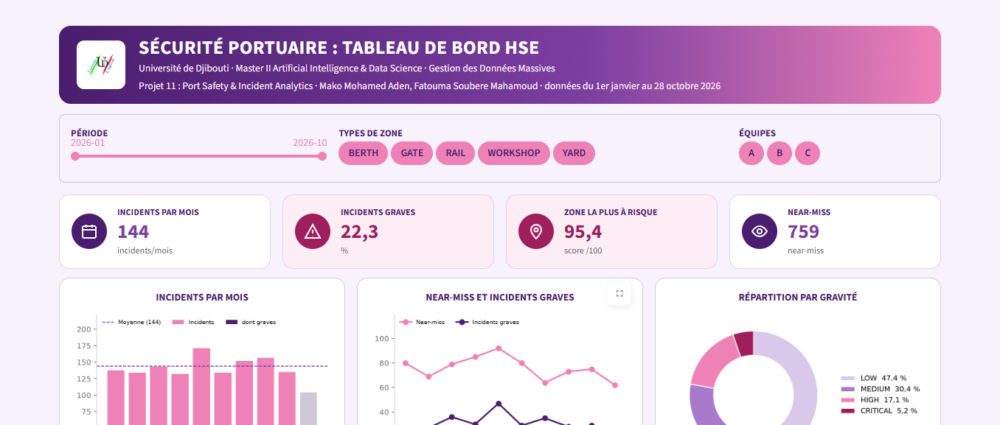
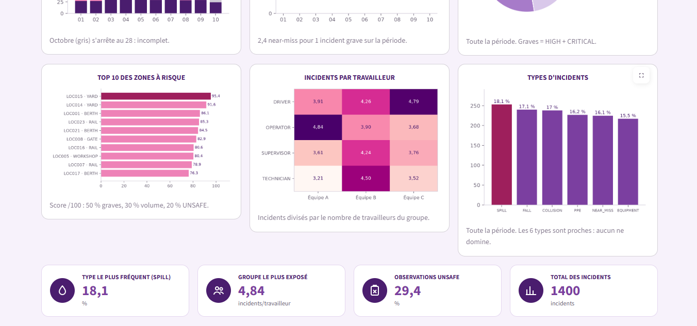
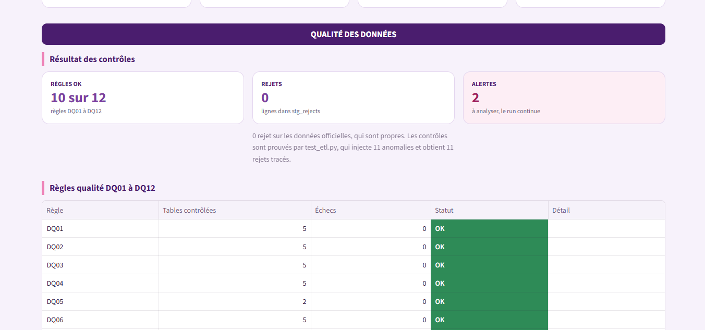

# 10. Architecture finale

## 10.1 Objectif

Cette section assemble les briques du projet en un schéma, de la source à la décision HSE. *Source : sujet, étape 8.*

## 10.2 Ce que nous avons fait

La figure 8, sur la page suivante, se lit de gauche à droite : les sources traversent les quatre couches du Data Warehouse, les tables MART alimentent l'analyse Python et le dashboard, qui servent les décisions du service HSE. L'archive HDFS, le suivi de la qualité et la gouvernance complètent la chaîne. *Source : `06_GOVERNANCE/lineage.csv` (36 liens) ; `11_ARCHITECTURE/faire_schemas.py`.*

**Tableau 21. Les composants de l'architecture**

| Composant | Outil | Rôle | Mise à jour |
|---|---|---|---|
| Base source | SQLite, SQL | Vérifier les sources, premiers KPI | À la demande |
| Data Warehouse | SQLite, Python (pandas) | Contrôler, modéliser, agréger | Un run complet à chaque livraison de sources |
| Archive | HDFS (Hadoop 3.3.6, Docker) | Conserver l'historique brut et les MART | Après chaque run |
| Analyse | Notebook Python (pandas, matplotlib) | Graphiques et interprétation | À la demande |
| Dashboard | Streamlit, une page | Afficher 8 KPI, 6 graphiques et la qualité des données | Lit la base à chaque ouverture |
| Suivi | Tables `dq_results`, `etl_run_log` | Tracer les contrôles et les runs | À chaque run |

Le tableau 21 montre des outils simples : SQLite suffit pour 5 315 lignes. *Source : `requirements.txt`. La mise à jour de l'archive est une proposition du groupe.*

**Figure 8. Architecture finale du projet**

**Le dashboard.** Le dashboard est une application Streamlit, en une seule page, qui se lit de haut en bas : un en-tête et trois filtres (période, types de zone, équipes) ; les 8 cartes KPI, quatre en haut et quatre sous les graphiques ; six graphiques (incidents par mois, near-miss et incidents graves, répartition par gravité, top 10 des zones à risque, incidents par travailleur, types d'incidents) ; puis la section « Qualité des données » (10 règles sur 12 OK, 0 rejet, 2 alertes DQ10 et DQ11, tableau des règles DQ01 à DQ12 avec le statut en couleur, dernier run de l'ETL, explication des deux alertes). Les filtres agissent sur les graphiques concernés : la période sur les deux premiers, les types de zone sur le top 10, les équipes sur la carte de chaleur. Les cartes KPI, la répartition par gravité et les types d'incidents portent sur toute la période. Le dashboard lit les tables MART et les tables de suivi ; il est en ligne à l'adresse https://projet11-port-safety.streamlit.app/ et, si la base n'existe pas au démarrage, il lance le pipeline pour la construire. Les figures 9 à 11 montrent la page, de haut en bas. *Source : `12_DASHBOARD/app.py`.*

**Figure 9. Le dashboard : en-tête, filtres, quatre premières cartes KPI et début des graphiques**

La figure 9 montre ce que le service HSE voit en ouvrant la page. Les trois filtres sont juste sous l'en-tête. Les quatre premières cartes donnent 144 incidents par mois, 22,3 % d'incidents graves, un score de 95,4 pour la zone la plus à risque et 759 near-miss : ce sont les KPI 1 à 4 de la section 9. Les deux cartes en rose pâle (incidents graves et zone à risque) sont celles qui doivent attirer l'œil. Sous les cartes, le graphique « Incidents par mois » montre la moyenne de 144 en pointillé et octobre en gris, parce qu'il est incomplet. *Source : capture du dashboard ; `12_DASHBOARD/app.py`.*

**Figure 10. Le dashboard : zones à risque, rôles et équipes, types d'incidents et quatre cartes KPI**

La figure 10 montre la suite de la page. Le top 10 place LOC015 en tête, en framboise, avec 95,4. La carte de chaleur désigne les opérateurs de l'équipe A (4,84 incidents par travailleur) comme le groupe le plus exposé. Le graphique des types d'incidents classe `SPILL` en premier avec 18,1 %, mais les six types sont proches. Les quatre dernières cartes donnent les KPI 5 à 8 : 18,1 % de `SPILL`, 4,84 pour le groupe le plus exposé, 29,4 % d'observations `UNSAFE` et 1 400 incidents au total. *Source : capture du dashboard ; `12_DASHBOARD/app.py`.*

**Figure 11. La section « Qualité des données » : trois cartes et début du tableau des règles**

La figure 11 montre l'état de la qualité des données au dernier run. Les trois cartes donnent : 10 règles sur 12 OK, 0 rejet et 2 alertes. Le texte sous la carte « Rejets » rappelle que les données officielles sont propres et que les contrôles sont prouvés par le script de test, qui injecte 11 anomalies et obtient 11 rejets tracés (section 5). Dans le tableau, chaque règle a un statut en couleur : vert pour OK, orange pour une alerte. Plus bas dans la page, non visible sur la capture, la section affiche le dernier run de l'ETL (13 novembre 2026, 1,48 seconde, statut SUCCES, 5 315 lignes traitées pour 4 900 faits) puis l'explication des deux alertes : DQ10 signale la hausse de mai (+29,5 % par rapport à avril, seuil de 25 %), un signal à analyser et non une erreur ; DQ11 signale que `home_area` ne correspond à aucune zone, une limite des données. *Source : capture du dashboard ; `12_DASHBOARD/app.py` ; tables `dq_results`, `stg_rejects` et `etl_run_log`.*

## 10.3 Pourquoi ces choix

Chaque brique répond à un besoin du service HSE. Le Data Warehouse donne des chiffres contrôlés. Les tables MART donnent des réponses directes aux quatre questions. Le dashboard les rend lisibles sans écrire de code. L'archive HDFS garde l'historique. Le suivi permet de savoir si l'on peut se fier aux chiffres du jour.

L'ordre des couches a aussi une raison de sécurité : plus on va vers la droite du schéma, moins les données sont sensibles. Les utilisateurs ne lisent que la dernière couche, qui ne contient que des agrégats (section 7).

## 10.4 Résultat

La chaîne complète se reconstruit en cinq commandes, listées en annexe B : construction de la base source, exécution du pipeline, tests, préparation de l'archive, lancement du dashboard. Le pipeline s'exécute en moins de 2 secondes. *Source : en-tête de chaque script ; table `etl_run_log`.*

## 10.5 Limites et hypothèses

- **Pas d'ordonnancement.** Le pipeline est lancé à la main. Aucun outil ne le déclenche automatiquement à l'arrivée de nouveaux fichiers. *Source : `README.md`, « Lancer le Data Warehouse ».*
- **Base du dashboard en ligne.** En ligne, la base est reconstruite au démarrage de l'application : le journal des runs ne contient alors que ce dernier run. *Source : `12_DASHBOARD/app.py`.*
- **Sécurité.** Les droits d'accès sont une politique écrite, non appliquée par SQLite ni par le cluster HDFS de démonstration (sections 6 et 7).
